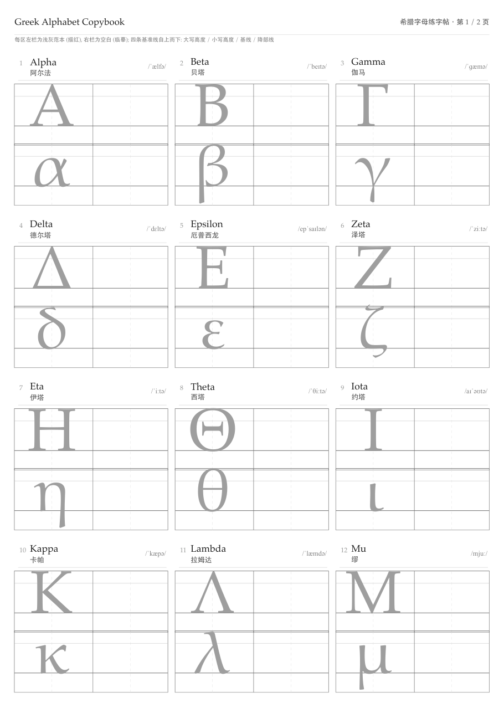
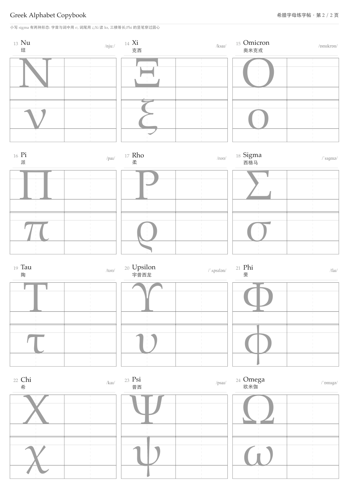

<div align="center">

# Learn Greek Letter

### 希腊字母练字帖 · 2 页 A4 · 可打印临摹

[**中文**](#readme) | [English](#english) | [安装](#安装) | [自定义](#自定义) | [License](#license)

[](LICENSE)
[](https://www.tug.org/tex/)
[](greek_copybook.pdf)

</div>

---

## 这是什么

一张**可以打印出来反复描摹**的希腊字母练字帖。24 个字母,2 页 A4,
每个字母都配好了英文名、中文音译、国际音标,以及大写和小写两套临摹格。

<p align="center">
  
  
</p>

## 为什么这样设计

### 问题:字母没有方块约束

中文练字帖靠**田字格**约束汉字——每个字都住在同样的方框里,横平竖直,
对齐是自动的。希腊字母是字母体系,**没有这种方块约束**,所以对齐完全靠手写者自己把握。

结果就是:字母写不好,绝大多数不是不努力,而是**没有度量基准**。
x-height 时大时小、β γ δ 的降部乱甩、Φ 的竖笔不在圆心——这些都需要基准线来约束。

### 解法:四线三格

本项目采用希腊语书写传统中的**四线三格**,自上而下四条基准线:

| 基准线 | 约束什么 |
|---|---|
| **cap line** | 大写字母顶端的高度 |
| **x-height line** | 小写字母顶端的高度(希腊语 x-height 较高,约为 cap 的 0.67) |
| **baseline** | 所有字母的基线 |
| **descender line** | β γ δ ζ η θ κ λ μ ν ξ ρ σ υ φ χ ψ 的降部底线 |

**这四条线的位置不是拍脑袋定的**,而是由字体的实测比例推算:

```
Palatino 实测:
  cap height  = 0.6968 em
  x-height    = 0.4683 em
  descender   = 0.1562 em
  最宽大写 Μ  = 0.9448 em

当前字号 71.5pt → 大写实际高度 17.5mm
```

所以你描摹时,字母该多大、尾巴该多长,格线已经标好了 —— 这是「对齐」这件事
从手感变成了可测量、可验证的东西。

### 每格的结构

```
 1  Alpha                          /ˈælfə/
    阿尔法
 ──────────────────────────────────────
 ┌────────────┬────────────┐
 │ 浅灰范本 A  │            │  ← 大写区:描红层 + 临摹层
 ├────────────┼────────────┤
 │ 浅灰范本 α  │            │  ← 小写区:描红层 + 临摹层
 └────────────┴────────────┘
```

- **左栏是浅灰范本** —— 直接在它上面描写,可以反复描
- **右栏是空白格** —— 脱离范本独立临摹,检验你真的记住比例了
- **英文名 / 中文音译 / IPA 上下叠放**,只占格位顶部约 15%,不挤压书写空间
- 一次打印就有 **96 次落笔机会**(24 字母 × 大小写 × 描红/临摹 两层)

### 版面预算

2 页 A4,每页 3 列 × 4 行 = 12 格:

```
格宽 64mm × 3 列 + 2 × 3mm 间距 = 198mm  ← 正好配合 6mm 页边距铺满 A4 宽
页边距仅 6mm —— 尽可能把空间让给字母
```

---

## 安装

### 依赖

| 依赖 | 说明 |
|---|---|
| **Python 3.8+** | 仅用标准库,无需 pip 安装任何东西 |
| **XeLaTeX** 或 **Tectonic** | 任选其一 |

### 安装 LaTeX 引擎

```bash
# macOS —— 推荐 tectonic,单二进制、自动拉宏包、无需 root
brew install tectonic

# 或完整 TeX Live(体积大,约 4GB)
brew install --cask mactex

# Debian / Ubuntu
sudo apt install texlive-xetex fonts-noto-cjk
# 或
sudo apt install tectonic

# Windows(需先装 Python)
#   winget install Tectonic.Tectonic
#   winget install Python.Python.3.12
```

> **首次构建需要网络**:tectonic 会在第一次运行时自动下载所需的宏包。
> 之后可离线构建(`tectonic -C`)。使用完整 TeX Live 则无此问题。

### 字体

项目使用三个字体,均为 macOS 自带。Linux 用户若缺字可安装:

| 用途 | 字体 | Linux 包 |
|---|---|---|
| 希腊字母 + 英文 | Palatino | `fonts-urw-base35`(或 `texlive-fonts-recommended`) |
| IPA 音标 | Times New Roman | `fonts-liberation`(Liberation Serif 兼容) |
| 中文 | STHeiti / Heiti | `fonts-noto-cjk` |

若字体名在你的系统上不同,编辑 `build_copybook.py` 中 `HEADER` 变量里的
`\setmainfont` / `\setCJKmainfont` / `\newfontfamily\ipafont` 三行即可。

---

## 使用

### 构建

```bash
git clone https://github.com/Liang-Guo-SD/Learn_Greek_Letter.git
cd Learn_Greek_Letter
./build.sh
```

产物是 `greek_copybook.pdf`。

### 打印

```
纸张     A4,纵向
缩放     100%
```

> ⚠️ **不要勾选「适合页面 / Fit to page」**。缩放会让整个格位等比缩小,
> 导致描红范本和四线三格对不上位,临摹就失去了基准意义。

如果打印机可选「实际大小 / Actual size」,优先选它。

### 练习建议

1. **先描红**:在浅灰范本上轻轻描写,重点是让字母贴合四条基准线
2. **再临摹**:在右侧空白格独立写,不参照范本
3. **打印多份**:这是最有效的练习方式。建议至少 5 份
4. **难写的字母单独加练**:β γ δ ζ η θ κ μ ν ρ υ φ χ ψ 有降部,
   ς 只在词尾出现(字首/词中用 σ),Ξ 三横等长,Φ 竖笔穿圆心

---

## 自定义

### 改字母数据

编辑 `letters.tsv`(制表符分隔,8 列):

```
序号	x(mm)	y(mm)	大写	小写	English	中文音译	IPA
1	0	17.6	\Alpha	\alpha	Alpha	阿尔法	ˈælfə
2	67	17.6	\Beta	\beta	Beta	贝塔	ˈbeɪtə
...
```

想改中文读音或音标,直接改最后两列,然后重新运行 `./build.sh`。

> 注意:`x` / `y` 是格位在页面上的坐标(单位 mm),改这两个值可以打乱排布顺序。
> 正常使用时不需要动。

### 改字母大小

编辑 `build_copybook.py` 中 `HEADER` 变量:

```python
\newcommand{\CapSize}{\fontsize{71.5}{71.5}\selectfont}
```

同时**必须同步**调整 `dXh` / `dBase` / `dDesc` 三个常量,让四线三格的比例
与新的字号匹配(比例关系见上文「四线三格」一节)。否则字母会坐在错误的线上。

### 改排版

- `build_copybook.py` 里的 `XS` / `YS` 控制网格坐标
- `build_copybook.py` 里的 `HINT1` / `HINT2` 控制页眉的提示文字
- `TraceZone` / `LetterCell` 两个宏控制格子绘制

### 直接用 XeLaTeX

```bash
python3 build_copybook.py    # 生成 greek_copybook.tex
xelatex greek_copybook.tex   # 编译(需跑两次)
```

---

## 项目结构

```
Learn_Greek_Letter/
├── build.sh              # 一键构建(自动探测 python / LaTeX 引擎)
├── build_copybook.py     # 生成器:数据 → LaTeX 源码
├── letters.tsv           # 24 字母数据(可编辑)
├── greek_copybook.pdf    # ★ 成品,可直接打印
├── greek_copybook.tex    # 生成的 LaTeX 源码
├── preview_p1.png        # 第 1 页预览
├── preview_p2.png        # 第 2 页预览
├── README.md
└── LICENSE
```

## 技术说明

用 **XeLaTeX + TikZ** 绘制。之所以选 TikZ 而非表格环境,是因为需要精确控制
每条基准线的位置、虚线中线的疏密、以及浅灰描红层的灰度。

生成器是 Python 而非手写 `.tex`,因为 24 个字母 × 2 页的重复结构手写极易出错,
而数据与排版分离后,改一个字母的读音只需编辑一行数据。

### 踩过的 LaTeX 坑(如果你想改造这个项目,值得先读)

1. **LaTeX 内置的 `\alpha` / `\Gamma` 在 TU 编码下是数学命令**,
   直接使用会报 `Missing $ inserted`。本项目为全部 48 个大小写字母生成了
   expl3 惰性定义。
2. **IPA 音标必须同样处理**。裸字符、`\newcommand`、`\char"XXXX` 全部失败,
   因为 LaTeX 禁止导言区产生任何排版内容,而这些写法在定义时就被求值,
   报 `Missing \begin{document}`。唯一可行的是 expl3 的
   `\cs_new_protected:Npn`(惰性,仅在正文展开时才输出字符)。
3. **expl3 函数名不能含数字后缀或下划线**。`\cs_new_protected:Npn \greekIPA1`
   会被拆成 `\greekIPA` + `1`;`\greek_IPA_Alpha` 中的下划线会在宏参数展开时断开。
   本项目用 `\greekIPAofAlpha` 这种「前缀 + 完整英文名」的形式。
4. **报错行号具有误导性**。正文调用处出错时,行号往往指向导言区的宏定义行。

---

## English

A **printable practice copybook for the 24 Greek letters**, fitting on 2 A4 pages.

<p align="center">
  
  
</p>

### Design rationale

Chinese handwriting copybooks use a **tian-zi-ge** (田字格) grid — every character
sits in an identical square, so alignment comes for free. Greek letters have no
such square constraint, so alignment must be *measured* rather than felt.

This project draws the traditional **four-line three-space** system used for
Greek handwriting:

| Line | Constrains |
|---|---|
| **cap line** | Height of capital letters |
| **x-height line** | Height of lowercase letters (Greek x-height is tall, ≈ 0.67 of cap) |
| **baseline** | The sitting line of all letters |
| **descender line** | Descenders of β γ δ ζ η θ κ λ μ ν ξ ρ σ υ φ χ ψ |

The line positions are **derived from measured font metrics**, not guessed:

```
Palatino (measured):
  cap height = 0.6968 em · x-height = 0.4683 em · descender = 0.1562 em
  widest capital (Μ) = 0.9448 em
  at 71.5 pt → actual cap height = 17.5 mm
```

### Cell layout

Each cell has the English name, Chinese transliteration and IPA stacked at the top
(occupying only ~15% of the cell), then an uppercase zone and a lowercase zone.
Every zone is split in two: a **light-grey model letter to trace over** on the left,
and a **blank cell for freehand practice** on the right — 96 strokes per printed copy.

### Build

```bash
./build.sh
```

Requires Python 3.8+ (standard library only) and either Tectonic or XeLaTeX.

```bash
brew install tectonic        # macOS, recommended
sudo apt install tectonic    # Debian / Ubuntu
```

### Print settings

```
Paper:      A4, portrait
Scaling:    100%  (actual size)
```

⚠️ **Do not enable "Fit to page"** — scaling shifts the grid and breaks the
alignment between the model letter and the guide lines.

### License

MIT — see [LICENSE](LICENSE).

---

## License

[MIT](LICENSE) © 2025 Liang-Guo-SD

字体版权说明:Palatino 与 Times New Roman 属 URW / Monotype 等字体厂商,
仅通过 LaTeX 的 `fontspec` 在本地调用,仓库内**不包含任何字体文件**。
